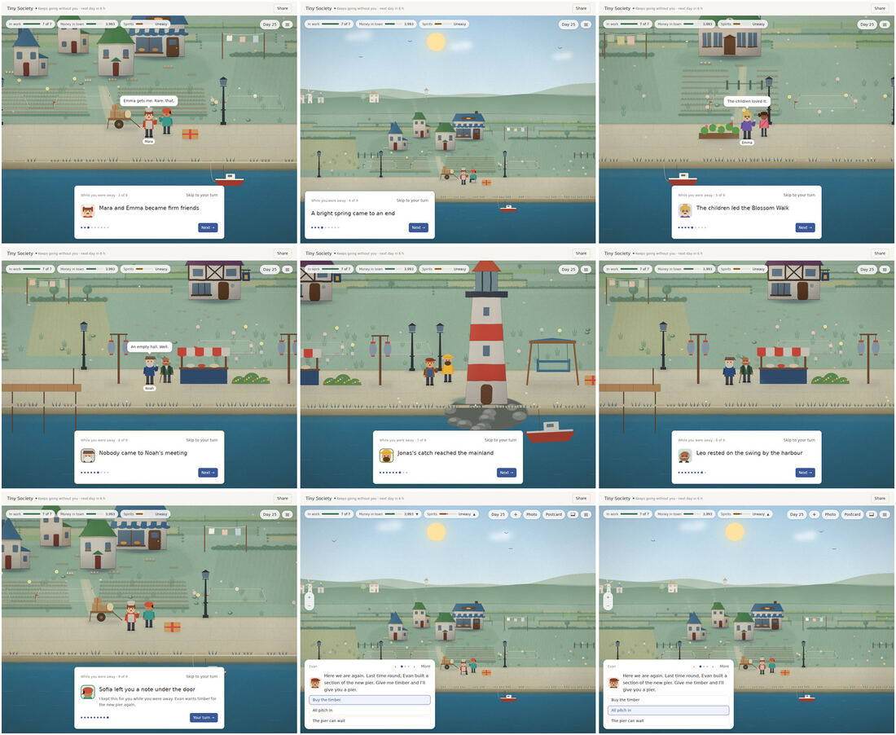
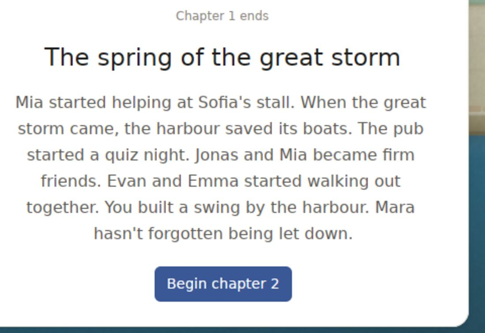
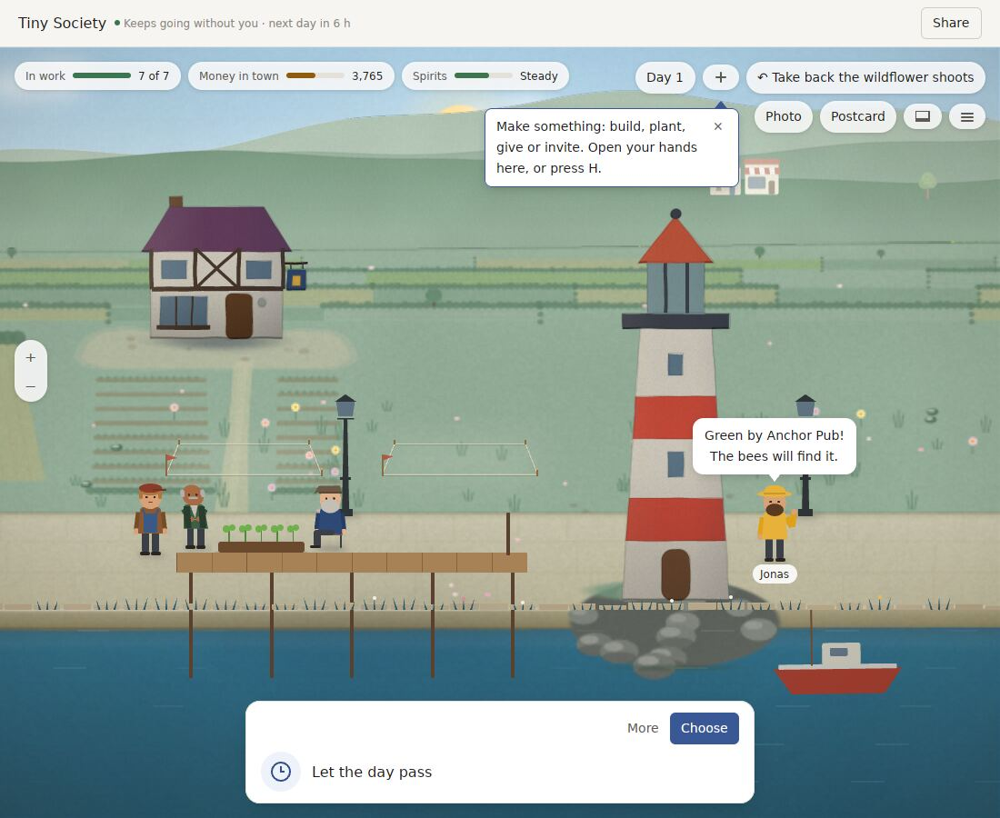
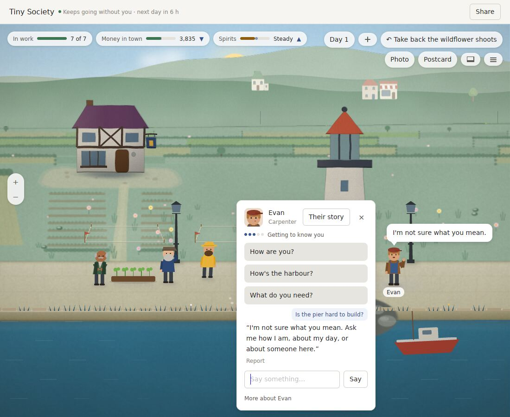
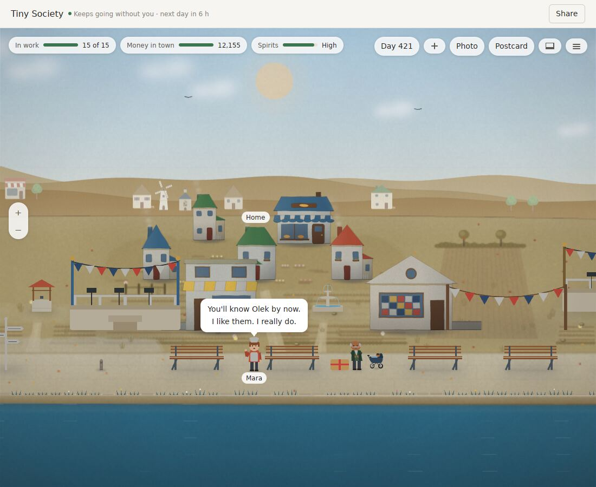

# World Machine v0.29: a step back, and the leap v0.30 should make

Reviewed on 2026-10-14 at `412d8cf` (v0.29.0, plus the nightly fix of #346).

The owner asked for a qualitative leap, not another round of fixes. So this review steps back further than the last six. It has three parts, each written independently:
- **Play and art:** v0.29.0 built in release and played in its real window under Xvfb by a critic who is also an art director. They covered:
  - a new World from day 1 to day 25, and its return after 72 hours;
  - a 420-day harbour;
  - each Pocket Universe place.

  About 150 screenshots, plus the text of the 420-day World read from its event log. No model key was available.
- **Architecture:** the whole tree and its git history from v0.23 to v0.29, the CI logs and the Actions history. Nothing was built.
- **Research:** web sources with URLs, dated 2026-10-14. As in the last two reviews, pages could not be opened through the network proxy. Every fact comes from search summaries, and the sales and player counts are third-party estimates. Read them again before money is spent on them.

The full reports and screenshots are kept in the review workspace.

## The verdict

**Twenty-nine releases have polished how frames look. None has changed what playing feels like.**

The craft is real:
- an event-sourced history that replays exactly, with a recorded cause for 90% of what happens;
- chapter cards with the best writing in the game;
- moment strips;
- the Ares cards ("there are no bees on Mars. Help me pollinate them with a paintbrush?");
- a dusk in year two under bunting.

But nobody would tell a friend about it yet. The critic expects most new players to stop between minute 15 and 25, for three reasons.

**1. The town's life is told, not shown.** The 420-day World holds 11,124 events, 6,156 of them residents living their lives. Friendships form, children are born, the bakery closes, three great storms pass. On screen the player sees two or three people standing still:
- No one walks, carries, works or sits.
- A storm is a caption ("Sky's turning black out west").
- The outing you arranged with Leo is agreed in words and then never happens.
- The return film is nine captions over standing figures: "Leo rested on the swing" does not show Leo on the swing.
- Chapter 1's card ("Jonas and Mia became firm friends. Evan and Emma started walking out together… Mara hasn't forgotten being let down") describes a month the player never saw.

**2. The player has no role and thin verbs.** You are an unexplained benefactor with a purse ("Money in town 3,835"). The loop is: read a card, pick one of two or three options, press Enter.
- "Everyone helps" is offered almost every time.
- Choosing "Buy the timber" makes a whole pier appear at once, with people already on its deck. There is no waiting and no making.
- Building is dropping one of 21 props on one strip of quay, and the swing snapped away from where it was clicked.
- Nothing you place is used on screen: the record says residents "rested on the bench", but no one is ever seen sitting.

**3. Time gives no reason to come back.**
- The bar says "next day in 6 h", yet Enter passes days without limit: the critic lived 25 days in 9 minutes and had seen the whole loop.
- Away time runs at four town days a real day, so a return after three days is twelve days of other people's news.
- Nothing you planted needs you tomorrow.

**And the residents do not become people:**
- Without a key, talk is a 28-intent parser. It fails on the most natural question: asked "Is the pier hard to build?", the carpenter said "I'm not sure what you mean. Ask me how I am…". On Mars, "Do you ever miss Earth?" got the same reply.
- All 78 letters in the 420-day World fill one template: opener, then two names, then "became firm friends" or "fell out", then sign-off.
- "Sold odds and ends outside Anchor Pub" is told 30–50 times per resident a year, and only 2,556 of 7,817 told lines are distinct.

**The look is competent, tasteful and still.** Night windows, Ares's habitats, the year-two dusk and the strips would sit comfortably in the Steam cozy mid-tier. Animal Crossing, Stardew, Spiritfarer and A Short Hike sell constant small motion; this frame is wallpaper:
- People are about 50 px tall in a side-on strip four and a half screens wide.
- 40–50% of each frame is inert sky and hills.
- Zoomed out, a year-two town is houses scattered on a beige field, with no streets and nothing joining one building to the next.
- A year-two noon shows 2 people; 15 are "in work".

**The engineering shows where the effort went.** Since v0.23 the tree grew from 175.6k to 246.5k lines of Rust, about 37% of it tests:
- **The painter:** the CPU-painted diorama and its painter are about 40k lines. They took 27% of all changed lines, and their golden tests take 58% of CI test time (907 of 1,569 s).
- **v0.28 and v0.29** went mostly on one class of bug, the rough stand-in showing where the player looks. That bug exists only because the scene is painted on the CPU in tiles.
- **Golden churn:** the 64 continuation digests were re-blessed six times in v0.29 alone, and 10 of its 33 commits touched goldens.
- **The split:** roughly 55–65% of v0.28 and v0.29 went to making existing things look and read right, plus golden, test and translation upkeep, and 20–25% to new things a player can do.

**Meanwhile the architecture's best abilities are barely used in play:**
- exact replay of recorded events;
- forking a World before any event (`fork_after` and `ForkBeforeEvent` work in both Packs, with no way to reach them);
- a year simulated headless in about 10 s;
- a recorded cause for nine events in ten.

**The research agrees with the critic.** The comparable hits grew on three things this game is thin on:
- a reason to have it in front of you every day (Neko Atsume, Rusty's Retirement, Bongo Cat);
- something unmistakably yours to make and show (Animal Crossing: New Horizons, Tiny Glade, Townscaper);
- stories players retell (Dwarf Fortress, RimWorld, The Sims, Wildermyth).

Open chat as the headline is weak: AI-native games on Steam mostly sell in the thousands, and games that disclose AI get about 53% fewer reviews. Language models earn their place when they react to what the player expresses, inside rules the model cannot break, with the output recorded rather than regenerated. That is exactly what this kernel does.

**All three reviews, written independently, point the same way:** make the life the simulation already produces visible, as a town that moves and a story told in scenes. Then build the daily return, sharing and the desktop companion on top of it.

## What the player found, in full

### The first hour, minute by minute

- **0:00.** A black frame, then the harbour on day 1. Leo: "Oh, a new face! I'm Leo. Welcome to the harbour." Nothing says who you are or what you are for.
- **0:10.** "Make something" opens unasked, offering free wildflowers.
- **0:20.** Clicking the roped plot puts a 70 px planter on the quay in front of it, not in it.
- **0:40.** The pier question fails (above). Every canned line carries a Report link.
- **1:30.** The pier appears whole (above).
- **2:00.** The hands catalogue has 21 props, and the swing snaps to the quay strip, overlapping the plot.
- **2:30–4:20, days 2–6.**
  - Three or four cards a day, and tooltips one after another.
  - One good causal echo: the oven was patched, and later Mara says "The patched oven's given up mid-batch".
  - Day 5's Spring Clean strip is the first real delight.
- **5:00.** The book says "13 of 78", and every keepsake is the same brown parcel. The one letter: "I wanted to tell you something. Not much news, only this: I ran errands for Jonas. Come by soon."
- **5:30.** A favour. Asked to watch the sunset on the pier, Leo answers "I'd love that. Mia put you up to this, didn't they?" Charming, and then nothing happens on screen.
- **6:00–8:30, days 7–13.**
  - Chapter 1 ends (above).
  - Day 13's "swallows" strip reuses Spring Clean's composition and its "around the swing you made".
- **Return after 72 hours.**
  - Home shows a lilac placeholder and "12 days have passed".
  - The film is captions over standees.
  - It ends on the day-1 pier card again: "Here we are again. Last time round…".

### Pocket Universe

- **Ares** is one keeper on a plain. The card writing is the best in the product, but the card's speaker, Tomas, is never on screen.
- **Soft lock:** in Ares and Maple Street, while the free bench offer is open, 9–15 presses of Enter advance nothing, and nothing says why.
- **Maple Street:** "Want to go to the arcade with me?" works, because place keywords are matched.

### The other problems, ranked by how much they block love

1. **The life is told, not shown.**
2. **No role, and thin verbs.**
3. **Time works against coming back.**
4. **Residents do not become people:** the parser, the template letters, the repeats, and templated pronouns ("Could I learn from them?" about Jonas).
5. **Expression and friction:**
   - placement ignores the click;
   - a gift parcel on the quay cannot be clicked;
   - the postcard toast hides behind the card;
   - Report appears on canned lines;
   - sharing is a 38,105-character code.

## What the architecture review found

**The layers are healthy:**
- **Kernel:** `world-core` is 3.2k lines, has no dependencies, and keeps every invariant.
- **Systems:** 32k lines.
- **Packs:** 61k lines, run out of process.
- **Voice:** 14k lines, bounded, and proved never to pay.

**The cost centres:**

| Cost | Size | What it costs |
|---|---|---|
| CPU tile painter and diorama | ~40k lines in `world-gpui` (63.6k total, doubled since v0.23) | 27% of changed lines, 58% of CI test time, most of two releases; keeps the town still |
| Goldens and digests | 64 continuation digests, 33 PNG goldens, 32 `.world` fixtures | re-blessed on every intended change, so they almost never catch a real bug; save compatibility is guarded separately, by event replay |
| Content | English inside Rust, plus zh and ja `.tsv` compiled into the app | one new line touches three languages, slot tests and digests; a new place needs an app-side enum and a 1.4–2.4k-line `works/*.rs` |
| Giant files | `world_window.rs` 7,122 lines (+23% in v0.29); `conversation/lib.rs` 5,948; `lives/lib.rs` 5,424; desktop `main.rs` 4,688 | agent collisions, and "found on the way" regressions every release |
| CI | PR test job 32.5 min; nightly red on 13 of the last 15 nights before #346 | slow feedback, alarms ignored |
| The only eyes | Xvfb with software Vulkan, 5 fps on 2.9 cores | no release since v0.21 seen on a real Mac, none ever played on Windows; four art rounds judged frames no player will see |
| Voice gating | ~25k lines plus ~130 corpus files | off by default, unmeasured with a real key, carries the disclosure and legal cost |

**What it is great at, unused in play:**
1. **Replay.** Saves from v0.20 onward replay event for event. Play uses this only for the return film and History.
2. **Forking.** It works in both Packs. `world-compare` (1.6k lines) is still in the tree, and "What If…" is still in the zh and ja catalogs, but no UI reaches any of it: it was cut in v0.18 as an analyst's tool.
3. **Headless speed.** A turn is 4 ms for a day passing, 23 ms with its look at three years, so a year runs in about 10 s.
4. **Causes.** Fewer than 10% of events now lack a cause.
5. **Out-of-process Packs, guests and World codes.** The start of a social layer.
6. **The desktop strip and near-zero background cost** (about 1% of a core when covered).

## What the research found (sourced in the report)

- **Animal Crossing: New Leaf → New Horizons** leapt on expression and sharing, not content:
  - terraforming, added because players were resetting their islands to get the layout they wanted;
  - Dream Addresses, offline visits that cannot change the island.

  Its failure mode was chore burnout and droughts between updates.
- **The Sims 1 → 2** leapt on ageing, memories and wants together. World Machine has ageing; memory of *the player* and visible wants are the lesson.
- **Tiny Glade** (two people, Rust) sold 616k in under a month on pure expression and screenshots, with a median playtime of about 1 hour. Townscaper calls itself a toy.
- **Rusty's Retirement** (an idle farm in a strip at the bottom of the screen) sold 500k+. **Bongo Cat** holds about 170k concurrent players and added friends on your desktop.
  - **Desktop Mate** fell from about 23k to 1.6k concurrent players in three months: a companion with no living world is a novelty.
- **Stories players retell** are the long tail:
  - Dwarf Fortress's Boatmurdered and Legends mode;
  - Wildermyth's comic panels and legacy heroes;
  - Spiritfarer's farewells.
- **Stanford's Generative Agents** were compelling because news spread between agents (a party invitation, dates, turning up on time), not because of chat. Infinite Craft records each generated result once, for everyone; that is this kernel's principle. Where Winds Meet's AI NPCs were tricked into paying out rewards, which is exactly what this game's "never pays" bound prevents.
- **AI disclosure applies to us regardless.** docs/press/ai-disclosure.md says the shipped lines, scenes, letters and translations were written with a language model's help. Steam treats that as pre-generated AI content, so the label applies whether or not the voice ships.
- **Steam is 94% Windows.** June 2027 is the realistic Next Fest (February's registration closes on 10 January 2027), and Wholesome Direct lines up with it.

## Candidate leaps

| | Leap | The player's promise | Why it's a leap | Size | Verdict |
|---|---|---|---|---|---|
| **A** | **The town you watch live** | Your town really lives on screen, and every story is a scene you can replay and share. | Turns the biggest hidden asset (a causal, replayable history of ~6k lived events a year) into the experience; fixes the painter's root cost at the same time | Large: about two cycles | **Recommended for v0.30** |
| B | The harbour beside you | A tiny town lives along your screen's edge all day; step in for five minutes. | The strongest 2024–2026 commercial evidence for tiny desktop teams | Medium, but needs A: CPU painting is too costly to run all day | v0.31, on top of A |
| C | The other road | From any choice, see what would have happened, and step into it. | Nothing else in the genre can do it; uses forking, replay and causes | Medium | v0.31–v0.32 |
| D | Build it with your hands | Shape lanes, gardens and a square, and the residents take them over. | Expression, the ACNH and Tiny Glade lesson | Large renderer and layout rework | Later, and only once A makes residents use what you place |
| E | Someone to care about | A few residents become yours over weeks: written arcs, letters about you, farewells. | Attachment, the one thing every peer has | Medium-large writing, in three languages | Folded into A, at a small scale |
| F | Residents with minds (AI as the core) | Talk to anyone about anything. | — | — | **Not recommended:** the guard is below its bars, the disclosure and legal costs are measured, and the evidence says it sells poorly as a headline |

## The plan for v0.30: "The town you watch live"

**One sentence:** the life the simulation already makes is shown on screen. Residents walk, work, carry and gather. Festivals, storms, outings, arrivals, births and builds play as short scenes. The return film is a cut of those scenes, replayed from the record with no model. And one day a day gives you a reason to come back.

### S0. The spike: go or no-go (first week, before anything else)

Bake the existing `tiny-skia` brush code's buildings, props, works and people into sprite sheets: 2–3 zoom levels and a few lighting variants, at load or build time. GPUI then draws them each frame as images.

**Go if all three hold:**
1. About 300 sprites move at 120 Hz with each frame planned in under 8 ms, **on a real Mac**.
2. One baked harbour frame earns the art director's yes against the bible.
3. Glow and light read well as layered images, since GPUI has no custom shaders.

If it fails, A falls back to keeping the painter and adding moving people and scenes as live layers over the still town. That is slower and less alive, but still the leap in substance.

**Result (2026-10-14): go.** The spike is `diorama/living_stage.rs`, the `living_stage_bench` example and the `living-stage-bench` app.
1. *Frame plan.* On CI's macOS runner (Apple silicon, real Metal, a 60 Hz virtual display), 300 walkers planned in 0.37 ms mean, 0.50 ms p95 and 0.92 ms max over 1,197 frames. No frame went over 8 ms, and the runner held 59.8 fps. After the per-picture cross-fade fix, headless p95 is 1.2–1.6 ms. 120 Hz on a real ProMotion Mac is not measured yet: no device is to hand. It moves to a release gate for v0.30, with a 60 Hz cap as the fallback.
2. *Art.* The art director said yes at noon and dusk, and no at night. Round 2 fixed the reasons:
   - the ghosted crowd, and people popping during the light cross-fade, both fixed by cross-fading each picture over itself;
   - halo size, now soft light the way the painter draws it;
   - the stall-roof smudge;
   - the beacon;
   - night window reflections;
   - the story props (build plots, washing line, handcart, moored boat);
   - the dusk water gradient.

   On re-review the art director said **yes at noon, dusk and night**, with no regressions. One S1 blocker remains: a walker is drawn over the lighthouse door, because people are not depth-sorted against buildings. Water texture and clouds/birds trail S1, but must land before sign-off.
3. *Glow.* Lit windows and lamp pools read well as layered images.

Two costs carry into S1. First, memory: a full bake is 400–680 MB of pixels, so S1 bakes lazily per zoom level and evicts. Second, Retina scale: it is not yet measured, and S1 adds a 2× bench run to CI.

### S1. The living stage

- Sprites composited on the GPU replace the tile painter. The rough stand-in, the tiles, the paint-ahead queues and "painted per region" accounting are deleted, probably 8–12k lines.
- A closer stage camera, with people at 120–160 px instead of about 50.
- One continuous ground that joins buildings with paths and lots.
- The interface hidden at rest, with numbers moved into the book.
- One hero palette per place with real value contrast, and dusk lit rather than tinted.

**Bars:**
- No rough painting ever, because there are no tiles.
- 120 Hz on a real Mac.
- The art director's free-play sign-off, on a real device.

**S1a (2026-10-14): the World window draws the living stage.** Both Packs' places go through it (`diorama/stage_view.rs`); the tile painter still paints the strip, covers, postcards and goldens, and is deleted in S1b.
- *Lazy looks.* A look is one zoom level (1x or 2x the display's scale) in one light. It is baked off the window's thread when the camera needs it. The close level is baked only around the camera. While a look bakes or is handed to the display, the nearest baked look stands in, scaled. Looks no camera is near are let go.
- *Memory and frame plan.* The headless `living_stage_bench -- window` run, 40 s of panning and zooming at 1100x848 on this 4-core box:
  - Day 1,082 at display scale 2: 59 MB at rest (zoom 1), 147 MB zoomed in to 2.2x, 147 MB at most. The spike's full bake was 400–680 MB.
  - At scale 1: 21, 45 and 45 MB.
  - Plan: mean 1.2 ms, p95 1.6 ms, 13 frames over 8 ms in 40 s.
- *Depth.* Buildings, things, people and the props along the spine are drawn back to front by where each stands. Residents' visits and walks stop beside a building's footprint, never inside it (`nobody_walks_into_a_building` checks every fixture).
- *World changes.* A new building, a story prop, the season, the weather or a resize gives a new key, and the look is baked again in the background. The old look stays until the new one is ready, and anything it lacks is drawn live meanwhile.
- *Left for S1b/S1c.* Delete the tiles, rough painting and paint-ahead queues. Re-bake only the affected sprites instead of the whole look. Add the closer stage camera. Run CI's scale-2 and macOS numbers on a real Retina Mac.

**S1b (2026-10-14): the frame-time bar, and the tile painter's World-window path deleted.** CI's macOS runner had measured S1a's window at scale 1 (plan p99 4.4 ms, 7 intervals over 33 ms) and scale 2 (plan p99 10.0 ms, 33 frames over 8 ms, 16 intervals over 33 ms). The bar for 120 Hz: plan p99 at most 4 ms at scale 2, and no interval over 33 ms once the place first shows.
- *Where the window's thread went.* A profile of the headless window bench (callgrind, its thread alone) put a quarter of each frame in laying the World out again, a tenth in cloning the frame (every resident and their drawing), and more in formatting the ladder's keys as strings and searching every sprite of a look for each building. Bakes on every core but one still competed with it on a three-core machine, and a pan along the close level baked the whole stretch again.
- *Fixes.*
  - A World is laid out once, and again only when the canvas, the drawings, the size or the hour changes or someone sets off or arrives. Layouts share one copy of the World.
  - A frame no longer clones itself, finds each item's sprites by item, and keys the ladder without formatting.
  - A bake leaves two cores free (the window's and the display's). A look waits for a short batch of poses. On a machine with few cores, poses wait for a look unless someone has none.
  - A look baked again takes every piece that is the same from the look before. Of the same World, that is each land tile, column of props, building and thing still in the cut. Of a changed World, it is each building and thing whose paint, and whatever stands in front of it, is unchanged. Its pictures are already with the display. It equals a fresh bake pixel for pixel (`a_look_baked_again_is_the_same_as_one_baked_from_nothing`).
- *Numbers.* Headless (`living_stage_bench -- window`), 40 s, the day-1,082 harbour at 1100x848, pinned to three of this box's four cores, two runs each:

  | | Plan mean (ms) | Plan p99 (ms) |
  |---|---|---|
  | Through a day, scale 1 | 1.11–1.12 → 0.51–0.53 | 2.0–2.1 → 1.1–1.2 |
  | Through a day, scale 2 | 1.16–1.20 → 0.55–0.58 | 2.4–2.7 → 1.4–1.6 |
  | Noon, scale 1 | 1.03–1.07 → 0.42–0.44 | 1.8–1.9 → 0.8 |
  | Noon, scale 2 | 1.05–1.09 → 0.45–0.46 | 1.9–2.1 → 0.9 |

  Before: four runs of each. After: two. Intervals over 33 ms are 0–2 a run, before and after, and frames over 8 ms 1–11. On this VM they land in any phase of a frame, including a layout kept or a plan of 50 µs. They are stalls of the machine, not work.
  - A pan along the close level takes 135 of the 186 pictures of its next look from the one before. The re-bake drops from about 0.9 s to 0.3–0.4 s.
  - The most pixel memory held at noon, scale 2, rises from 142 to 165 MB, because the look a bake takes from is kept until it is done.
  - Both benchmarks now print the bar as a line, and what each bake took from before, so CI's macOS run shows whether the bar is met. That run is the judge; this box has no Metal.
- *Deleted.* About 3,200 lines:
  - the scene element that painted the still layers off the window's thread and faded them in;
  - the rough painting and its flat stand-ins, and the count of how much of it showed (the frame log keeps the columns, at 0, for the harness);
  - painting ahead of the camera (where it heads, the next return beat, a zoom step away) and the Frame fields that fed it;
  - the painter's priorities, opening allowance and measured hand-over cost.
- *Kept, and why.* The strip, covers, postcards and goldens still paint a frame's still layers in place, a tile at a time (`interface::paint`), with the same pieces as before. Moving them onto the living stage's bake would re-bless every golden picture without an art review. So no golden picture changed, and `replayed-state.digest` was not touched.
  - Tests of the deleted path went with it: the scene's arrival and fade, rough never over sharp paint, a new look's fade, the boil settling zoomed out, landing on sharp paint, and the tile painter's frame-time benchmark.
  - The zoom control's test keeps its checks of the zoom itself.
- *Left for S1c.* The closer stage camera. The bar judged on CI's macOS run and a real Retina Mac. The live drawing that remains each frame (clouds, the ridge, ground light) as baked layers if the Mac's numbers still need it.

### S2. Residents who move

- Six to eight animated verbs: walk, carry, sit, work, wave, gather or dance.
- Driven by what the record already says each resident is doing: at the stall, in the pub, on the quay, on the bench you placed.
- Things you place are used visibly: a bench gets sitters, a lamp gathers people at dusk, a stall gets a keeper.

**Bar:** at least 6 residents visibly doing something on any first screen of a lived town, by day.

**S2d (2026-10-14): the World window shows what the record says each resident is doing.** S2a–c gave every outdoor stop of a resident's day a stance and a companion; the window now draws them (`diorama/people.rs`, `scene.rs`, `mod.rs`, `stage_view.rs`).
- *What wins.* Walking (with a load, carrying it), then a wave, then what an errand has them do, then the stop's stance, then the Pack's, then an idle moment. A stop that says nothing is drawn as before.
- *Benches.* Sitters sit on the bench's own seat: up to three, a body's room apart, hips at the top of its plank (each library bench's seat height, `works::seat_of`), shins reaching down so the feet stay on the ground in front of it. Nothing floats, and no stool of their own. A seat higher than 0.6 P is not sat on.
- *Lamps.* Those gathered at a lamp on land stand either side of its post and further round toward the viewer, a horseshoe facing in, never in the post or hidden behind it. Companions stand on the same side, facing each other, talking.
- *Stalls.* The keeper stands just behind the stall, so it is drawn first by depth and its counter hides their legs. Whoever brings a load stands at its side.
- *Wells, fountains and plantings.* Used from their side. Someone who sits there brings their own seat.
- *Companions.* Two whose day has them together stand side by side, facing each other (they change places with a neighbour if gathering split them).
- *Carrying and dancing.* A load (a crate of the catch by water, greens and fruit where there is none, in the place's own wood) is held at the waist, hands at its sides. Walking to or from a carry stop uses the walk's steps with the arms held forward, so no extra pose set: a carrier's loaded steps take the place of their empty ones. Dancing is four beats drawn in stances every drawing already has (arms up swaying one way, a hand high on a skip, the other way, a hand high), each resident on a beat of their own. The Pack drawings are unchanged, so `drawn_as` stays as the fallback for drawings without parts of their own, and no projection golden moved.
- *Errands, not random visits.* The hash-seeded visit is gone. An errand is a pure function of who, the World's day, the hour and how far into it (`errand_at`): in half the three-minute stretches of an hour, out to the nearest thing to use (buy at a stall, draw water, tend the beds, rest by a bench), forty seconds there, and back. A carrier goes back where the load comes from and returns loaded. It never runs past the hour, and `seconds` only breathes and turns heads, ready for S4's clock.
- *Releases.* A frame tells the display to forget at most 8 pictures (was 24, a 50 ms frame at scale 2 on CI's Mac), and their pixels are freed off the window's thread once nothing else holds them.
- *Tests.* `sitters_feet_on_the_seat`, `pairs_adjacent_and_facing`, `gatherers_outside_the_lamp_post_footprint`, `the_keeper_stands_behind_the_stall_in_depth`, `living_is_a_function_of_snapshot_and_clock`, `a_load_is_carried_and_a_dance_has_beats` and `nobody_on_an_errand_or_at_a_fixture_is_in_a_building` (every fixture, five hours, every 20 s of each) in `diorama/doing_tests.rs`. In both Packs, `six_residents_busy_on_first_screen_by_day` opens every saved fixture in the window's own layout and opening view at 9 to 16 o'clock.
- *Numbers.* Headless `living_stage_bench -- window --dpr 2`, 40 s, 1100x848, three cores: the day-1,082 fixture at noon has plan mean 0.42 ms and p99 0.81 ms (S1b: 0.45 and 0.9), most held 167 MB (165). The Pack's own day-1,082 town at 15:00 has 0.40 and 0.76 ms and 166 MB. Through a day: 0.49 and 1.1 ms, 271 MB at most while two lights cross-fade. No interval was over 33 ms.
- *Not met yet.* Everyone on a first screen is busy at every hour from 9 to 16 in every saved fixture. But six or more are on it only where six stand there at all: the five latest harbours (6–8) and the grown Pocket Universe places. The three oldest harbours open on their welcomer with two to five residents round them, and the young places of a keeper or two on two to five. The window opens on whoever speaks, and the Pack spreads people's work stops along the whole panorama. Bringing six into that view is S1c's camera or the Pack's day, not posing.
- *Goldens.* No golden picture changed: the scene's fixtures carry no stop stances, and a stop that says nothing is drawn as before. `replayed-state.digest` and the projection goldens are untouched.
- *Left.* Close-up art review of the sitters (three on a bench read crowded at 2.2x), the ring at the beacon on the hill, and the keeper under low stall roofs. Dancing has no stop in today's saved worlds (only festival days), so it is seen in the staged close-up only.

**S2d round 2 (2026-10-14): the art director's NO, answered.**
- *The keeper behind the counter.* The window's plan already drew the keeper before the stall. The close-ups came from the painter that paints people over the still layers, where the keeper's legs showed over the counter. There the stall is now painted again over its keeper (`PersonPaint::behind`). Two tests now check it: one through the window's own plan (the keeper's pose drawn before every stall picture it meets), and one in painted pixels (no pixel of the legs below the counter). Both fail if the keeper stands in front.
- *Nobody on a building.* Ring spots, spots beside a thing and a dance's ground are taken only on open ground: in no footprint, and never at or just behind a building's foot where its picture is. A lamp hemmed in by houses (the hill beacon) is ringed at the foot of the hill, on the line people stand. `every_lamp_ring_stands_on_open_ground` puts six at every lamp of the three-year town from 19 to 22, and the building test now covers 19 to 22.
- *The ring.* Up to six spots a side, either side of the post and round in front of it, balanced left and right. Companions take the spot level with each other.
- *Benches.* Sitters are 0.6 P apart (about 1.3 body widths); a bench too short for three seats two, and the third sits on a stool beside it.
- *Dancers* move along their lane, together, to ground with nobody else within a stride.
- *The load* is a crate half their height wide, hip to chest, outlined, with slats, in the place's wood or wicker or dark wood, whichever is furthest from their clothes in lightness.
- *Motion strips* (`motion_strips`, ignored): a dance over six moments and an errand out and back, at the window's own zoom.
- *The return-film test.* It failed here and on CI, on main as well as this branch: the first two frames bake the place synchronously (5.4 s and 2.8 s here, the same on main), longer than a beat, so the film went on by itself before the click. The test now puts the film back on its first beat until a frame of it is drawn with the beat still there (once the place is baked, a frame is quick), takes Next's bounds from that frame, and sets the beat with no frame drawn before the click. S2d did not slow these frames: they take the same time on main. It still fails if a click leaves the beat's clock running.

**S2d round 3 (2026-10-14): the beacon's ring, benches, errands.**
- *Rings only where there is room.* A ring spot must be open ground within 1.5 P of the lamp, off every thing too (a pool's rail, a pier, a cart), not only buildings. A lamp with no such ground forms no ring, and its gatherers stay where their stop stood them. So the hill beacon, hemmed in by two houses, has none, and nobody stands on the bathing pool's rail. `every_lamp_ring_stands_on_open_ground` now checks distance and props too, with a prop put down beside each lamp. It fails without the fix.
- *Benches.* Sitters spread along the whole plank (0.62 of its width, end to end). Every bench sitter shows both legs: the far one a shade darker, behind the near one. A fourth who does not fit sits on a stool beside the bench, and the staged close-up shows one.
- *Errands end somewhere.* An errand goes only to a thing on the walker's own ground, at least two strides off, and one they can walk to without a building in the way. They walk all the way there (someone slower takes longer), stop facing it, use it (buy at a stall, draw water, tend the beds, sit a while by a bench), and come back. With nothing to use, they call at a reachable door, talking. A baby's pram goes nowhere on its own. One of a group now and then goes too and comes back.
- *Walks at the start of every hour (an old fault).* Someone whose stop began hours earlier walked there again from their previous stop at the start of every hour. A walk now happens only in the hour its stop begins.

### S3. Every story is a scene

Each type below plays as a staged scene of 5–10 seconds, with the camera, people and props moving. Together they cover about 80% of the events that reach the player:
- festival
- storm
- outing (the favour you arranged)
- arrival
- birth
- quarrel and making up
- a build going up by hand

The return film becomes a cut of these scenes, replayed from the recorded events. Invariant 6 makes that free of any model. Chapter cards follow the scenes they describe instead of replacing them.

**Bars:**
- Every return-film beat shows its event happening.
- A stranger watching a 20-second clip can say what happened (4 of 5 testers).
- Arranged outings always play.

**S3c (2026-10-14): a scene staged on the living stage.** S3a–b gave every recorded Event a `SceneScript` (who walks where, props, camera, the recorded words), worked out from the record with no model. `diorama/staging.rs` plays one on the stage the window draws.
- *Pure.* `stage_scene(script, stage, snapshot, t)` gives who stands where (position, facing, stance, a walk under way), the props out, the camera and who is saying what. It depends on the script, the stage and `t` and nothing else: no clock, no record.
- *Marks.* Each mark is found on the stage:
  - a place, or a person (where their part has them, or where they stand);
  - someone's home;
  - beside something, a step or more to its side;
  - off the left or right edge of the scene's first view.

  A mark it cannot find falls back to the scene's place. Everyone is put on open ground, using S2d's open-ground test (now `people::Ground`). That means in no building, on no thing, behind no post in the water, and clear of the props and of each other.
- *Walks.* A walk at the start of a scene puts them there. A later one walks with the walk cycle everyone already uses (`people::walking`), along their line, stopping beside any building in the way (`kept_out`). If they need to be somewhere for their next cue, they hurry, up to twice a stroll. If even that is too slow, they set off from nearer.
- *Facing.* A pair a mark put together (a quarrel's two) face each other. Anyone else faces the nearest of the others, else the camera's subject.
- *Who is staged.* A cast member with no cues of their own is not drawn. Anyone cast who is indoors at that hour is brought out (`cast_on`). Everyone else keeps their day: `living_staged` takes the scene's part for its cast.
- *Props.* Props are drawn live in depth with everyone, by `staging::paint_prop`: scaffolding and tools, bunting, a table, a cradle, a lamp, a wreath, a ribbon, a bag, a bouquet, a bench.
  - A prop beside someone goes where they go.
  - A ferry, shuttle, bus or sled only comes in to the edge of the view, and goes again.
  - None of it is baked into the looks (`bake_key` is unchanged), so a scene never re-bakes the place.
  - Rain from `Weather(Rain)` falls from its cue to the end of the scene, over a frame whose World weather is clear (`Frame::shown_weather`).
- *Camera.* The camera eases over 1.2 s from one camera cue's view to the next, and follows a person it is on. A script's zoom maps to the window's as zoom + 0.2, from 1 to 2.2, so a long harbour never folds into a postcard mid-scene. On a building further back, the view rises to take in its roof, with the people still above the card.
- *Tests* (`diorama/staging_tests.rs`, all on pinned clocks):
  - positions at the start, middle and end of an arrival, a quarrel, a festival, a build, a birth, a farewell and a storm;
  - the cast in view at each camera cue;
  - `nobody_staged_is_in_a_building_or_on_a_prop`: every fixture, seven kinds, every quarter second;
  - speech only as recorded, and none from a speaker who is not on the stage;
  - only the cast with a part are staged;
  - living takes the scene for the cast and the day for everyone else;
  - a dressed frame bakes the same as an undressed one.

**S3d (2026-10-14): the return film plays its scenes.**
- *What plays.* A beat whose selection is a recorded Event asks the World once for `StoryRequest::Scene` (cached by revision and beat, asked as the beat begins).
  - It holds for `script.seconds`.
  - Its camera drives the film's camera, eased by the glide as it lands and then directly.
  - Its cast stands and walks where it has them, with its props around them.
  - Its Say cues are the speech bubbles, over whoever said them.
  - The card's caption is as before.
- *Unchanged.* A beat with no scene (no Event, or one the World stages nothing for) plays exactly as before: `BEAT_SECONDS`, the camera on `beat_box`, the beat's voice.
- *What the player sees.* After a while away, each beat shows the event happening:
  - the ferry comes in at the edge, someone walks off it with a bag, and the neighbours wave;
  - two talk face to face, and one walks off home;
  - bunting and a table go up, and everyone walks in and dances;
  - scaffolding stands round the work, everyone works, and it comes down to a cheer;
  - rain falls, and everyone hurries home while a lamp is lit.
- *Tests* (`window/scene_film_tests.rs`):
  - every beat with a scene plays it and lasts `script.seconds`, an arranged outing included; beats without one last `BEAT_SECONDS`; each scene is asked for once;
  - in the window, a scene holds its beat past a beat's while, and the film goes on after the scene's length;
  - only the scene's recorded words are heard.

  The beat clocks are set, never waited on. A test-only `beat_clock` pins how far into a beat the pictures are.
- *Numbers.* Headless `living_stage_bench -- window --dpr 2 --hour 12`, 30 s, 1100x848, day 1,082, three cores. Without a scene: plan p99 0.54 ms. With a festival or an arrival playing (new `--scene <kind>`, looped): p99 0.51–0.55 ms, mean 0.25 ms. With a quarrel (zoom 2): p99 0.54 ms. No interval was over 33 ms. The bar of 4 ms is met with room to spare.
- *Pictures (for the art director, not goldens).* `WORLD_GPUI_SCENES=dir cargo test -p world-gpui -- --ignored scene_pictures` writes the start, middle and end of each of the seven kinds on the day-1,082 harbour in the World window, and a six-frame strip of one whole festival beat. They are drawn through the reference rasteriser, so there is no text. No golden picture changed, and `replayed-state.digest` was not touched.
- *Left.*
  - Someone who has left the World (the one who goes at a farewell long ago) is not on the canvas, so is not staged.
  - Rain does not darken the light, only streaks.
  - The capture's bubbles and card have no words.
  - A "Play this" control on a moment's page is not added.
  - Art review of the props on a real device.

**S3c/S3d round 2 (2026-10-14): the art director's NO, answered.** Arrival and Farewell passed the stranger test. Festival and Birth half read. Quarrel, Build and Storm failed.
- *Storm.*
  - It now reads as a storm. The sun and blue sky go behind a cloud deck (`staging::paint_overcast`, drawn live over the sky's pictures and under the hills), and the gulls go.
  - The light is cooled and dimmed (a cool wash, never grey: the art bible's §4). The rain is heavy streaks that read at the window's zoom, and the ground by the water is wet. The scene's lamp glows through all of it.
  - All of this comes from the scene's weather (`Frame::shown_weather`, `scene_storm`) on the live layers. No look is baked again.
  - It sets in over 1.5 s. There is no lightning flash over a scene's storm.
  - Everyone hurries home (1.6x a walk) and goes in at their door. Someone gone in is drawn by nobody (`Staged::indoors`).
- *Quarrel.*
  - The two stand a clear gap apart, facing each other, cross (`Mood::Cross`, where the face shows mood).
  - One walks home and goes in. If home is too far to reach, they walk well away.
  - Nobody stands on the planter.
- *Build.*
  - The scaffolding stands round what is going up, at its own foot: a thing's or a building's.
  - The tools lean against the scaffolding at its foot.
  - The workers stand on that same ground.
  - The sample (the bench's and the pictures') builds the thing on the people's ground with the most room about it.
- *Overlaps.*
  - Everyone the scene stages, and every prop, is put on the nearest open ground. That is ground clear of buildings' feet and faces, of every thing on the people's ground (taken at its depth: someone may stand a step in front of a planter, never on it), of the posts in the water, and of each other. It is tried on the people's line and a step or two in front of it.
  - Two of the cast stand at least a body's width apart unless a cue puts one right up against the other (`APART`).
  - Nobody of the town is stood on.
  - Everyone else is held where their day has them while the scene plays (no errands, no strolls), so the scene's blocking stays clear of them.
  - Bunting's poles stand on open ground, never on a boathouse door or a tide gauge, and whoever is nearer stands in front of them.
  - Someone walking a distance goes along a near lane in front of whoever stands about, unless a building stands out into it. Then they keep to whichever line is clear, so no walk ever crosses a building's ground. A building that blocks the way stops them at the nearest open ground this side of it.
  - Someone who could not be there in time, or could not get there at all, sets off from nearer.
  - Someone who walks off the edge of the view is gone, not left standing there.
- *Camera.*
  - A festival's camera comes in at 1.5 s, not 5 s, in the template (`chronicle::scene`) and the sample.
  - The ferry rides lower in the water, its cabin below the quay's edge.
  - The return film's card docks once a beat and stays put (`Looking::film_dock`).
- *Birth.* The neighbours cheer at 5.5 s, so the middle and the end differ. This is in the template too.
- *The parcel on the quay steps* is no leftover of staging. It is the World's own "Bread crates for the hotel" (an order, `MarkShape::Parcel`) in the day-1,082 fixture. It is left as it is.
- *Tests.*
  - `nobody_staged_is_in_a_building_or_on_a_prop` now runs every fixture at 11 and at 14 o'clock, every quarter second. It checks:
    - nobody's feet in a building, at any moment of a walk;
    - nobody standing on a prop, on a thing, or on anyone of the town;
    - the cast a body's width apart unless paired by a cue;
    - every prop that stands on the ground, and bunting's poles, on open ground and not on a thing.
  - The quarrel test checks the gap, the facing, the moods, and the one who goes home going in.
  - The build test checks one work site: the tools against the scaffolding, at its foot, on the people's ground, and the workers by it.
  - The storm test checks that it sets in and that people go in.
- *Pictures.* `scratchpad/v030/s3c/r2/` has the seven kinds at start, middle and end, plus a festival strip and a storm strip.
- *Numbers.* The blocking is worked out every frame. With a festival, a storm or a quarrel playing, the headless `living_stage_bench -- window --dpr 2 --hour 12 --scene <kind>` (20 s, day 1,082, three cores) has plan p99 0.62–0.63 ms and mean 0.31 ms (round 1: 0.51–0.55 ms). No interval was over 33 ms. The 4 ms bar is still met.
- *Left.*
  - The arrival's ferry, at the left edge, can still sit under the card when the card docks left.
  - The camera follows a leaver to where they leave, so the waiting ferry can end up under the card.
  - A real-device look at the cross faces, which are small at this zoom.

**S3c/S3d round 3 (2026-10-15): the art director's second NO, answered.** Arrival, Festival and Storm passed the stranger test. Farewell, Build and Birth half passed, and Quarrel failed.
- *Farewell (blocker 1).*
  - The one leaving walks along the shore to the ferry waiting at the edge of the view, steps down onto its deck (`Blocking::board`) and waves from it. The ferry sails at 7.4 s, with them aboard.
  - The camera stays on the place all through. The template no longer follows the leaver, so the ferry stays at the edge of the view and does not slide under the card.
  - A ferry, shuttle, bus or sled now comes all the way into the view (`TRANSPORT_IN`). A shuttle, bus or sled is walked up to and gone into, not stood on.
- *The card (blockers 1 and 5).*
  - A return beat's card now docks once for the whole scene (`world_window::scene_dock`). It takes whichever of centre, left and right covers least of the scene. That is counted over everyone the scene stages and every prop it shows, wherever its camera has them, every half second of the scene.
  - It depends only on the scene, the stage and the window. So it is the same however far into the beat the window is first drawn.
  - The card jumping across the storm strip had two causes:
    - Each frame was docked by the crowd at that moment.
    - The pictures staged the scene on a stage taller than the window's. The window's stage sits under its gauges (`CHROME`).
  - Both are fixed: the dock comes from the whole scene, and the pictures now use the window's stage.
- *Quarrel (blocker 2).* It is now in the body, from each Pack drawing's own parts (`people::postured`). No Pack art was added and the Pack-name ratchet is unchanged.
  - One squares up, hands on hips. The other folds their arms. Neither shows the open hand of talking.
  - Just before going, the one leaving turns their back. They then stomp off: quick hard steps leaning forward, 1.5x a brisk walk (`Posture::Stomping`).
  - The one left behind folds their arms and turns away from where the other went.
  - The camera comes in as close as it goes (template zoom 2.0).
  - The postures are carried as `StagedPerson::posture`, then `Dress::postures`, then `PersonPaint::posture`. `PoseKey` includes the posture, so a cached sprite is never the wrong pose.
- *Build (blocker 3).*
  - The scaffolding's whole span, ladder included (`staging::scaffold_span`), must be open ground. It must be clear of every thing but the one it surrounds, of every prop and of the posts in the water.
  - Where it cannot stand round the work like that, it stands on the nearest open ground along the line.
  - The sample picks a build site where it fits.
  - The tools lean against it, outside where that is clear, otherwise just inside.
  - Each worker who is working swings a hammer in four beats (`Posture::Hammering`, `people::paint_hammer`), each worker on their own beat.
- *Storm (4).*
  - The full-frame wash is gone. The sky darkens (`paint_overcast`, and a wash down to the horizon), and the land only cools a little (6%). It stays close to its day value, in line with the art bible's §4.
  - The lamp is lit on the place, where the camera is (template: beside the place). Its glow is a warm pool round it and on the ground beneath it, and reads at the window's zoom.
  - The stones by the water are wet and shine.
  - Everyone of the town out in the view starts for home a moment after the rain comes (`Blocking::take_shelter`), as does the cast. Anyone a building stops short goes in under its cover. Nobody stands out in it at the end.
- *Birth (6).*
  - The parent stands, rather than carrying a crate, and the cradle is right at their side on their own line. If there is no room for it there, the parent stands at the nearest spot that has room (`Blocking::room_beside`).
  - Nobody stands right in front of the cradle.
  - The camera is closer: 1.6 at the start, then 2.0 on the parent.
- *Openings (7).*
  - Arrival opens at 1.4 and Festival at 1.2. Festival then closes in to 1.6.
  - The arrival's camera comes in on the place rather than following the newcomer, so the ferry stays at the edge.
  - Whoever stands off the edge at the start stands on no thing out there.
- *Camera.* The view is framed on the nearest line anyone in the scene stands on, so the cast stays above the card's band where the stage allows.
- *Templates.* `chronicle::scene` and the sample changed together:
  - arrival zoom and camera;
  - quarrel zoom;
  - festival zooms;
  - birth parent, cradle and zooms;
  - farewell camera and when the ferry sails;
  - storm lamp.
- *Tests.*
  - `a_quarrel_is_in_how_they_stand`, `a_cradle_has_its_parent_beside_it_all_through` (at 11 o'clock on the tests' stage and at 14 on the window's), `a_farewell_ends_aboard_the_ferry` and `a_storm_leaves_the_quay_empty` (every fixture).
  - The build test now checks that someone is hammering.
  - `nobody_staged_is_in_a_building_or_on_a_prop` now checks the scaffolding's full span against every thing (except the one it surrounds) and every post, in every fixture at both hours.
  - In `window/scene_film_tests.rs`:
    - `the_card_keeps_clear_of_each_scene_at_every_camera_cue`: on the window's stage, at 11 and 14 o'clock, for all seven kinds. At each camera cue and at the end, the camera's subject (or else whom the scene is about) and every prop it shows are outside the card's rect.
    - `a_beat_card_stands_still_through_its_scene`: the storm beat's card is in the same place at seven moments, each docked afresh.
- *Pictures.* `scratchpad/v030/s3c/r3/` has the seven kinds at start, middle and end, plus the festival and storm strips.
- *Numbers.* Headless `living_stage_bench -- window --dpr 2 --hour 12 --seconds 20 --scene <kind>` on day 1,082 with the release build:

  | Scene playing | Plan p99 | Plan mean |
  |---|---|---|
  | Festival | 0.66 ms | 0.32 ms |
  | Storm (now with the town's walks home) | 0.65 ms | 0.33 ms |
  | Quarrel | 0.67 ms | 0.33 ms |

  Round 2 was 0.62–0.63 ms. No interval was over 33 ms, so the 4 ms bar is still met.
  - The bench does not measure the beat's dock. It is worked out once a beat, on the beat's first frame, and stages the scene about 17 times. It is not timed here.
- *Left.*
  - At the festival's dance, on the window's stage, the nearest dancer's legs reach into the card's band. At that zoom the camera cannot go any lower on the stage. The dock picks the side that covers fewest, and the test checks only the subject and the props.
  - The faces are still small at the window's zoom. The quarrel now reads from posture, but it still needs a look on a real device.
  - The hammer's swing has four steps, so it is a little jerky.
  - The scaffolding stands at the build site, around the thing being built only when it fits there. Elsewhere it stands on open ground beside the work.

### S4. One day a day

- The town's day follows the real day, or follows each sitting, by the owner's choice (decision 2).
- Enter no longer passes days without limit.
- Away time no longer compresses into twelve days of news.
- A small daily ritual:
  - a morning letter written to you, about your shared past rather than a template;
  - one choice with weight;
  - one thing to tend overnight (a garden, or a build you finish by hand);
  - one find for the book.
- Never punitive: missing a day costs nothing (the Neko Atsume lesson).

**Bars:**
- Every day has something new that is yours.
- No day's ritual repeats a line.
- A five-day think-aloud test (decision 3).

### S5. Residents become people (small, focused)

- **Letters:** about you and what you did together, replacing the one template.
- **Pronouns** fixed.
- **Hearing grounded in place and occupation:** the carpenter knows the pier, the keeper knows Earth.
- **Repeats:** none of the "lived" lines told more than 5 times a year per resident.
- **Heart arcs:** one written arc per core resident, spanning several cards and favours. Two residents per place, in three languages.

### S6. Share a story

- Export a scene or the return film as a short clip (GIF or MP4), captioned in the reader's language.
- A short World link or file replaces the 38,105-character code.

**Bar:** a clip plays and reads correctly with no app.

### S7. Friction first (first days, in parallel with S0)

- the Pocket Universe free-offer soft lock;
- placement that ignores the click;
- the unclickable parcel;
- the postcard toast hidden behind the card;
- Report on canned lines;
- the black first frame.

### S8. Pay for it: what to stop and delete

The stop list:
1. Shrink the 64 continuation digests to a representative few; don't delete them all. Event replay of every archived save proves each log rebuilds the same state, but not what happens after a load. So keep, per Pack, the continuation and snapshot-wire digests for the oldest and the newest fixture: open, make choices, pass days, compare later snapshots, new events and the process wire output. That is about 8 digests instead of 64, plus one replayed-state digest per Pack, so a regression on the first day after a load is still caught and an ordinary content change re-blesses a handful of files, not 64.
2. Move golden render tests out of PR CI and into the nightly in release mode, after giving `world-gpui` an optimisation level in debug and measuring. The PR run should be under 15 minutes.
3. Stop releasing daily with 490-line reviews and full KNOWN_ISSUES rewrites. Release when a slice is playable, with a short changelog.
4. No art rounds on Xvfb frames. Sign-off happens on a real Mac or PC (decision 3).
5. Freeze the voice: no new red-team sets, judge work or lexicon growth until there is a key and a ship-or-cut decision (decision 5).
6. Retire wall-clock asserts in debug tests. Run the nightly on the release branch too.
7. Split `world_window.rs`, desktop `main.rs` and `conversation/lib.rs` before S1 starts (about one agent-week of mechanical work).
8. Delete what nothing uses. Keep `world-compare` and the fork intent for leap C.

### The order

1. S7 and S8's splits and CI cuts, alongside the S0 spike.
2. The go/no-go.
3. S1, then S2 and S3 together.
4. S4 and S5.
5. S6 last, because it needs scenes worth sharing.

S2 and S3 are the leap itself. If time runs short, S6 and the S5 arcs move to v0.31; S1–S4 do not.

### What would prove the bet wrong

Five think-aloud players watch a lived town for ten minutes and cannot say what anyone is doing, or a stranger shown a 20-second scene cannot say what happened. Run that test on the S0 spike's frames, with even one scripted scene, before committing past it.

## Decisions only you can make

| # | Decision | Options | Recommendation |
|---|---|---|---|
| 1 | The leap | A "the town you watch live" / B the desktop companion first / C the other road / D building | **A**, with B as v0.31 on top of it |
| 2 | Time | one town day per real day / one day per sitting / keep free Enter and add the ritual | **One day per sitting**, capped, with a non-punitive real-day ritual; the softest version of the return hook |
| 3 | A real Mac and a real Windows PC | buy or borrow now / keep judging on Xvfb | **Now.** The S0 go/no-go and every art sign-off depend on it; the last nine releases were never seen on a real screen |
| 4 | AI disclosure | keep the label (the shipped text was written with a model's help) / have a person rewrite the shipped text | Keep the label for v0.30, and decide before the Steam page goes up; the label applies whether or not the voice ships |
| 5 | The voice | freeze / cut from the default build / ship it with a key | **Freeze** until there is a key to measure it with |
| 6 | Cadence | daily releases / a release per playable slice (about weekly) | **Per slice.** v0.30 is about two cycles of work; pre-releases can go out for testers |

## Status of v0.29's work since release

- **Nightly bars** were red every night after v0.29 merged. #346 fixed them: the blind-set test is skipped, a memento and the work it marks count as one telling, and four Pocket Universe bugs from v0.29 are fixed. It ran green on its branch, and the first green run on `main` is pending.
- **The release workflow's publish step** failed after publishing v0.29.0, because a Windows file was named as a plain path in a `nullglob` array. #345 fixed it.

## The owner's answers (2026-10-14)

The owner accepted every recommendation:
1. **The leap:** A, "the town you watch live", with the desktop companion (B) as v0.31 on top of it.
2. **Time:** one day per sitting, capped, with a non-punitive real-day ritual.
3. **Real devices:** a real Mac and a real Windows PC go in the loop. The S0 go/no-go and every art sign-off are judged on them. Until a device is to hand, the spike is also measured on CI's macOS runner (real Metal, a virtual GPU) as an interim reading, and the owner runs the spike's benchmark build on their own Mac.
4. **AI disclosure:** keep the label for v0.30, and decide on a human rewrite before the Steam page goes up.
5. **The voice:** frozen: no new red-team sets, judge work or lexicon growth until there is a key and a ship-or-cut decision.
6. **Cadence:** a release per playable slice, with pre-releases for testers.
