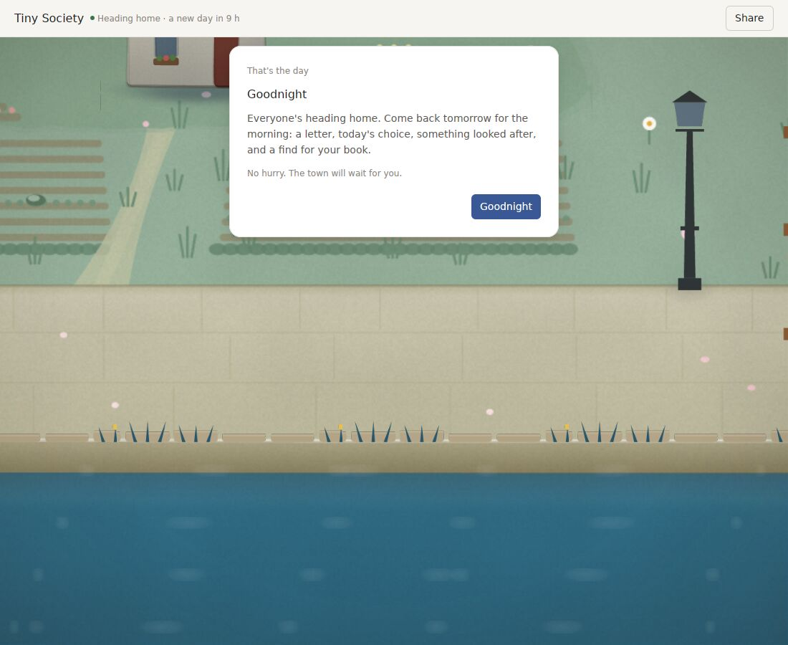
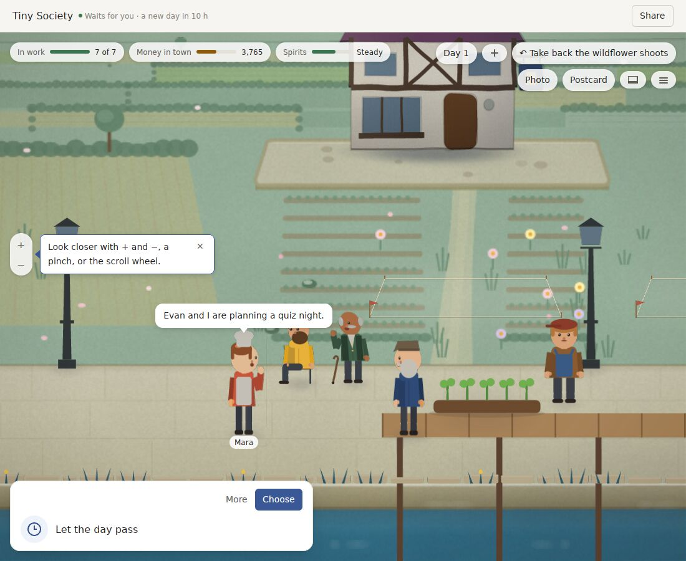
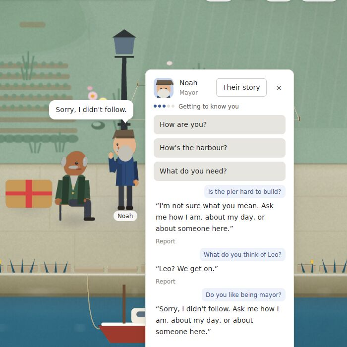
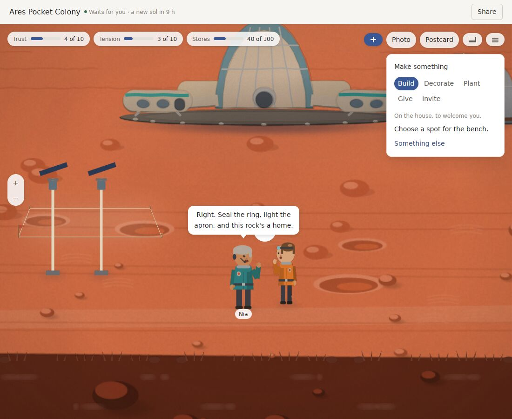
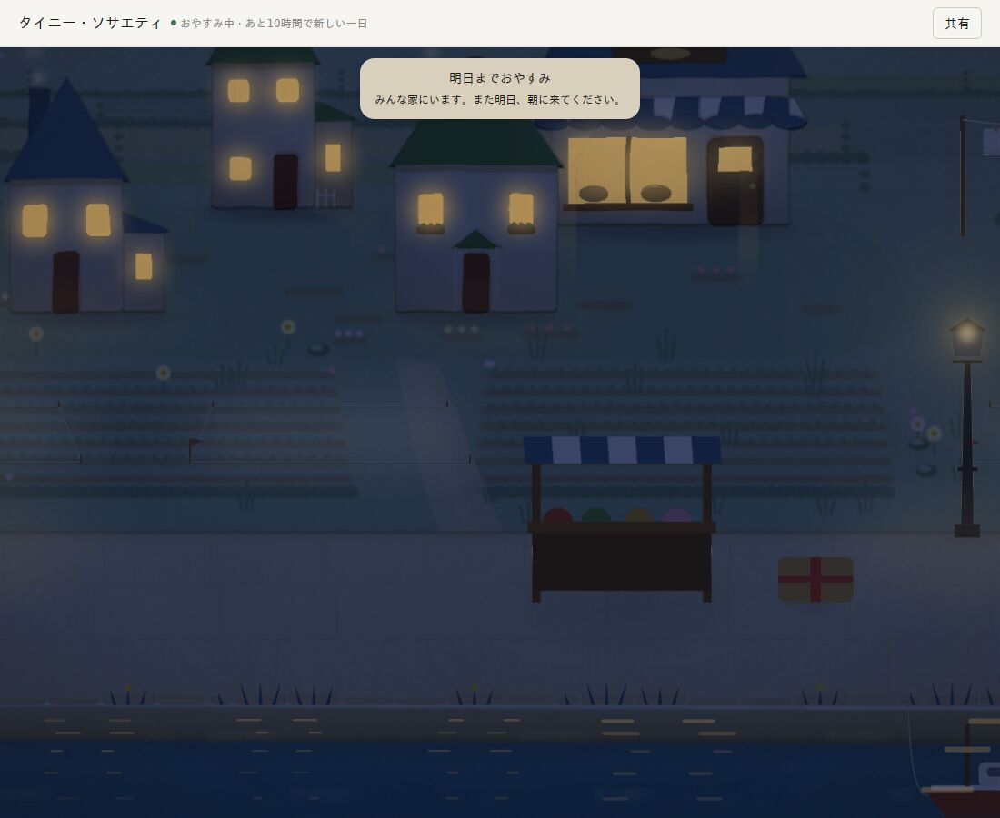
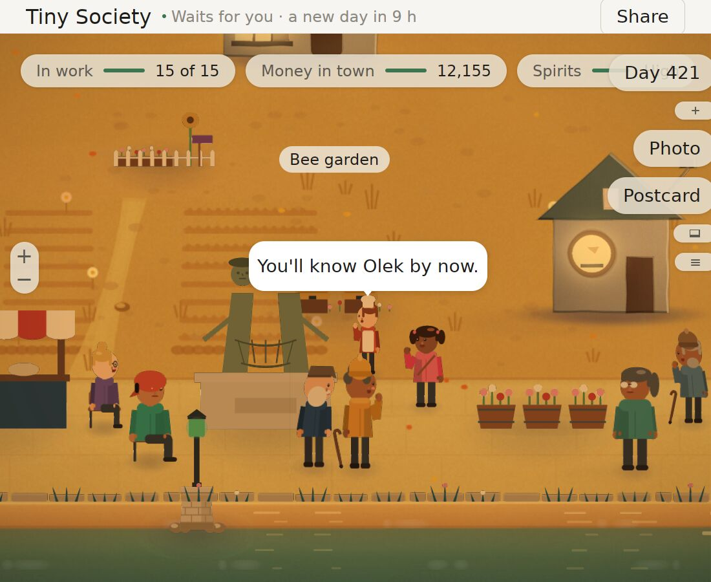
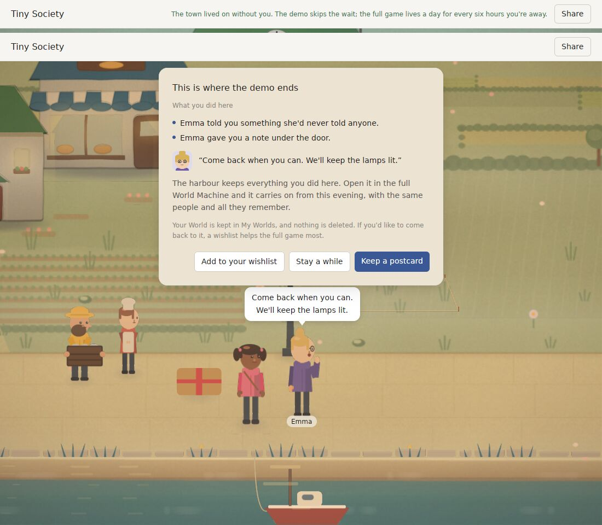
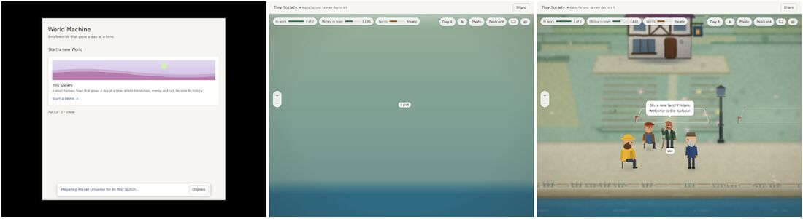
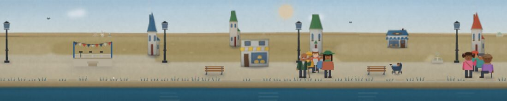

# World Machine v0.30: what stands between it and a finished product

Reviewed on 2026-10-30 at `d06eb85` (tag `v0.30.0`).

The owner asked for the next major version to **finish productization**: a game a stranger can find, buy, install, play for weeks and recommend. The owner also decided: **no compatibility with any earlier version or record.** 1.0 starts its own save format, and nothing from v0.x needs to open or replay.

The review has four parts, each written independently. The full reports and 185 screenshots are kept in the review workspace.

- **Play and art.** A critic who is also an art director built v0.30.0 in release and played it in its real window under Xvfb, with no model key and no sound device. They covered:
  - a new World across four sittings, and one World across 17 sittings;
  - a 420-day harbour, read from its event log;
  - every Pocket Universe place;
  - Settings, Chinese and Japanese, 200% text, postcards, World codes, the strip and the demo.
- **Productization.** Every area a shipped desktop game needs, checked against the code, the docs, the releases and the Actions history.
- **Architecture and engineering.** The whole tree, CI and nightly history, and the release pipeline. Nothing was built.
- **Market.** Web research dated 2026-10-30. Valve's and Microsoft's own pages were outside the network allowlist, so their rules come from search summaries and secondary coverage. Sales figures are third-party estimates unless a developer published them.

## The verdict

**v0.30 changed how the town looks. It did not change what playing feels like, and almost nothing a customer needs around the game exists yet.**

What v0.30 got right, and must be protected:
- the close camera, 140 px people with faces, and residents gathered in rings;
- the asleep harbour at night, the best frame in the product;
- the morning card;
- letters that cite what you did;
- today's choices and the finds;
- chapters 1 to 10, the best writing in the game;
- the sitting ledger, which ran 17 sittings without a fault.

What the player meets instead:
- **Day one ends at minute 6** on "Come back tomorrow", and the window locks. Later sittings last 1 to 3 minutes. Four real days give a new player about 15 minutes of play.
- **The loop is still: read a card, press Enter.** "Buy the timber" makes the whole pier appear in half a second, and the planter you placed jumps onto its deck. Placement ignores where you click.
- **Talk without a key is unchanged from v0.29.** Asked "Is the pier hard to build?", the carpenter says "I'm not sure what you mean", and every canned reply carries a "Report" link.
- **Every Pocket Universe place soft-locks on its first day.** A free "Make something" offer opens by itself, and Enter does nothing until you find a plot to click.
- **Variety thins out.**
  - Only 5 of 78 letters cite the player over 420 days.
  - All 14 "looked after" lines in 17 sittings were about the same wildflowers.
  - The finds run out after 28 mornings.
  - Narrated summaries are 29% distinct, against 33% in v0.29.

**Around the game:**
- **Nothing is signed.** v0.30.0 shipped ad-hoc signed and not notarized, and its main DMG has 1 download. On macOS Sequoia an unsigned app needs a trip to System Settings to open at all.
- **No Windows build has ever been made.** The Windows release job was skipped in every release run, and no window has ever opened on Windows. About 94% of Steam's users are on Windows and about 2% on Mac.
- **There is no store build and no store page.** There are no Steam capsules and no trailer, the screenshots are v0.28's, and the press contact reads "To be filled in".
- **Nothing has been measured on a real device or with a real person.** That includes 120 Hz, a Retina Mac, battery and memory on a Mac, sound, the think-aloud, the stranger test and a native read of Chinese and Japanese.
- **The nightly has been red every night since v0.30 merged** (16–30 Oct), on three real regressions. The release did not depend on it, and nobody was told.
- **Third-party notices are missing from the app and the installer**, though the MIT and BSD licences of the code it links require them.
- **The name may collide:** "World Machine" is an established terrain-generation product, and no trademark search is on record.

**Accessibility and the app surface claim more than they deliver:**
- Reduce Motion cannot be turned on: there is no setting, and only tests set it.
- 200% text makes the top bar overlap and clips Photo and Postcard.
- Off macOS, Settings, About, Save As and World codes exist only in a menu bar Linux doesn't show; Settings opens only with Super+,.
- There is no title or welcome screen: the first launch flashes Home and drops you into a dashboard.

## What each review found, in short

### Play and art (full report: PLAY.md, 21 ranked problems)

- **Where a new player stops:**
  1. Minute 4–5, when typed talk fails.
  2. Minute 6, at "Come back tomorrow".
  3. Sitting 3 or 4, when the morning letter says "I slept in" and the looked-after line repeats.
- **The look:**
  - At night it reaches the upper Steam cozy mid-tier. By day it is mid-tier; zoomed out or at dusk, below.
  - Against Animal Crossing, Stardew, Spiritfarer and A Short Hike it lacks ground that joins the buildings, props at human scale (benches are about twice too big), dusk that is lit rather than tinted, passers-by and small constant motion, and an interface that hides at rest (it covers 10–15% of the frame).
  - The strip squashes houses into spires. Icebridge's first frame no longer shows its nests and bridge.
- **Smaller slips:**
  - Copy:
    - "Packs · 2 · show" untranslated;
    - "Follow the Mac" and "nothing leaves this Mac" on Linux;
    - Settings still describing v0.29's return;
    - the demo promising "a day for every six hours you're away".
  - Behaviour:
    - Enter doesn't press "Begin the day";
    - a raw "ZBus Error" in the title bar when the Save dialog fails;
    - a letter says find Emma while the button says Find Sofia;
    - Home says Day 4 after Goodnight on day 3;
    - World codes are a 41,000-character clipboard string.

### Productization (full report: PRODUCT.md, 29 rows over 16 areas)

**1 done, 17 partial, 9 missing, 1 untested, 1 waiting on the owner.**
- **Done:** export and import.
- **Works:**
  - the release pipeline (universal DMG, demo, manifest, checksums), and a signing path that waits only on secrets;
  - an update banner, diagnostics and a log;
  - the model key kept in Keychain or Credential Manager;
  - an honest KNOWN_ISSUES.
- **Missing:**
  - anything signed, any store build, any real-device evidence or human playtest;
  - native-language review, legal review, notices;
  - a minimum macOS version (an older Mac crashes instead of explaining);
  - an fps cap or battery mode, master mute, an in-app Reduce Motion, controller support;
  - restore from backup.
- **Localization:** 54 catalog keys are in Japanese but not Chinese, and about 15 desktop-app strings have no catalog entry at all. Every translation is model-made.

### Architecture (full report: ARCH.md)

- **Healthy:**
  - `world-core` is domain-free: 3,155 lines, no dependencies, 4 commits since v0.24.
  - The boundary script and the Pack-name ratchet hold.
  - Wall time is isolated from the World.
  - The key store is sound; `deny.toml` is strict.
  - Re-runs are rare, so the tests are not flaky.
- **The nightly's three failures:**
  1. A three-year warm builder's World code is 51,492 characters, over its 50,000 cap.
  2. S5a's new letter lines are partly English in Chinese and Japanese.
  3. A three-year Pocket Universe turn with its save takes 29–36 ms against a 30 ms bar.

  A fix is in progress. It changes code, not the bars.
- **CI:**
  - PR CI takes about 29 minutes (target: 15).
  - Every PR push runs twice (push and pull_request), wasting about 40% of macOS and Windows minutes.
  - The 29 PNG goldens test the tile painter, which the World window no longer uses.
  - v0.30 re-blessed digests in 11 commits.
- **Size:**
  - `world-gpui` is 81,000 lines, 30% of all Rust, and grew 17,400 net in v0.30.
  - `world_window.rs` is 7,410 lines, one `impl` of about 4,160 of them, and the most-changed file.
  - The desktop `main.rs` holds 107 platform `cfg` lines.
- **Saves:**
  - The archive's `format_version` has not changed since v0.17, and `written_by` is recorded but never compared.
  - The sitting ledger is device-local, so a World moved to another machine, or synced through Steam Cloud, starts a fresh first sitting.
  - The owner's decision removes the need to carry old formats, but 1.0 needs its own contract.
- **Unmeasured:** GPU time anywhere, a real 120 Hz Mac, Windows GPUs, sessions of hours, battery. Memory at rest has doubled to about 200 MB.
- **Safe to delete:**
  - `world-compare` (1,650 lines; nothing uses it);
  - the observer's catch-up API;
  - the always-zero frame-log columns;
  - `NEXT_TASK.md`;
  - the stale ROADMAP;
  - debug env knobs honoured in release builds.

### Market (full report: RESEARCH.md)

- **Comparables:**
  - Tiny Glade: $14.99, 1M+ wishlists, 616K copies in its first month; reviewers called it "a toy, no goals".
  - Fields of Mistria: $13.99, Early Access to 1.0, 98% positive.
  - Hozy: $15, 100K copies in 4 days.
  - Little Kitty, Big City: $24.99, "too short for the price".

  Small cozy games sell at $10–15 when they have one clip-friendly mechanic; games without goals get "toy" reviews.
- **A daily cap on PC divides players.**
  - Cozy Grove's was called "better suited to mobile", and its sequel went mobile-only. Hello Kitty Island Adventure's daily caps were called "walls".
  - Steam's two-hour refund window means the first session must show the whole loop.
  - Recommendation: a sitting is a session, not 24 real hours; an opt-in "play freely"; never punish absence or a changed clock.
- **Generative AI is the biggest reputational risk.**
  - Surveys in late 2025 found 85% of players negative, and 83% negative on AI-written dialogue.
  - Steam requires disclosure of live-generated content and a description of its guardrails, and players can report it from the overlay.
  - At least one game was asked by Steam review to remove cloud-LLM and API-key support.
- **The bar for a finished cozy game:** saves with Steam Cloud, achievements, settings and accessibility, controller and Steam Deck, long-term goals or an ending, stability, and Simplified Chinese and Japanese first. Simplified Chinese passed English on Steam in 2024.
- **Costs:**
  - Steam: $100 per game.
  - Apple: $99 a year.
  - Windows signing: about $10 a month (Azure, US and Canada individuals only) or an OV certificate at about $200–380 a year. Builds installed through Steam don't meet SmartScreen.
  - A rating through the free Steam questionnaire; unrated games are hidden in Germany.
  - Year-one hard cost: about $320–550.
- **Calendar:** Next Fest runs 22 Feb–1 Mar 2027 (registration about 10 Jan) and 14–21 Jun 2027. A demo released months before a fest earns about 2.5 times the wishlists.
- **Wishlists:** about 7K reaches Popular Upcoming, 25–30K makes a solid launch, and first-week sales are typically 0.10–0.15 times launch wishlists.

## What "finished" means for World Machine 1.0

1.0 ships when all of these are true:
1. A stranger on Windows or Mac installs it from Steam, signed, without warnings or workarounds.
2. The first session is 20–40 minutes long, shows the whole loop, and never soft-locks or says "I don't understand".
3. Thirty sittings in a row each bring something the player hasn't seen, and the first year has an arc and an end the player can reach.
4. Every verb has feel: building takes time and people, what you place is where you clicked, and what you place gets used.
5. The game is complete with no AI at all.
6. Settings cover what Steam players expect: volumes, fps cap, text size, Reduce Motion, language, controls. Accessibility claims are true.
7. Saves are versioned from 1.0, refuse a newer version cleanly, can be restored from backup, and travel through Steam Cloud with their sitting.
8. Measured on four real devices; played by people in a think-aloud and a closed beta; Chinese and Japanese read by native speakers or labelled honestly.
9. The store page, demo, trailer, press kit, notices, EULA, privacy policy, AI disclosure and age rating are done and true.
10. Every gate is green on the release commit: CI under 15 minutes, nightly, release-shots, the Windows smoke, the soak.

## The plan: v1.0 "A finished harbour"

Seven slices. Each ships as a pre-release (owner answer 6). Tiny Society is the 1.0 product. Pocket Universe stays in the build but is not marketed; it can follow as a free update. That is decision 4 below.

### P0. A clean base (first, about 2 weeks)

- **Fix the nightly at the root cause** (in progress), make release publishing require a green nightly on the release commit, and notify on red.
- **Drop every compatibility obligation from v0.x** (owner's decision):
  - delete the v0.20–v0.27 fixtures, the continuation and replay digests, the compatibility tests, the observer catch-up API, `world-compare`, and the code that only reads old formats;
  - keep determinism tests built on 1.0 Worlds.
- **A 1.0 save contract:**
  - `format_version` 1;
  - a newer save refused with a clear message;
  - the Pack version bumped whenever an Action, System or payload changes;
  - one fixture per release from 1.0 on;
  - restore from the last good `.bak`.
- **The sitting ledger moves into the World file** as non-authoritative host metadata, not events. A World moved or synced keeps its sittings. Wall time stays out of events and state.
- **CI under 15 minutes:**
  - one trigger per PR;
  - test sharding;
  - the tile-painter goldens out of PR CI, re-based on the living stage;
  - release-shots on PRs that touch the window;
  - a file-size ratchet.
- **Split** `world_window.rs`, the desktop `main.rs` (moving its `cfg` code to `platform.rs`), `conversation/lib.rs` and `lives/lib.rs`.
- **Delete or replace stale documents:** `NEXT_TASK.md` and the stale ROADMAP go, and the old REVIEW files move to `docs/archive/`.

### P1. The first hour (about 3 weeks)

- **A title and welcome screen:** the town at dusk, Continue / New / Settings, and a one-line promise ("A small harbour that grows a day at a time").
- **An in-window app menu on every platform:** Settings, About, Save As, World codes, Help, Quit.
- **The friction list:**
  - the Pocket Universe soft lock;
  - placement at the click;
  - the unclickable parcel;
  - Enter on "Begin the day";
  - the hidden postcard toast;
  - the raw "ZBus Error";
  - the Emma/Sofia and Day 4 slips.
- **The first session is designed, not counted:** 20–40 minutes, the whole loop (a request, a build that takes time, a letter, a festival preview, a first find), then Goodnight.
- **Report never appears on a canned line.**
- **A stale-copy pass** over every string, in three languages: no Mac words on Windows or Linux, no v0.29 clock, no "lives while you're away".

### P2. Time that respects the player (about 2 weeks)

- **A sitting becomes a session.** The first sitting runs to Goodnight at the end of the designed first session. Later sittings bring one new day, and the evening can be played out; the day is not a timer.
- **"Play freely" (opt-in in Settings).** Goodnight offers "Sleep now" and the next day comes at once. There are no penalties and no lock-outs either way.
- **Asleep is not locked.** The Book, letters, finds, postcards and the town at night stay open; only passing a day waits.
- **The title bar and Home say what is true:** "Asleep · a new day in N h", or "Play freely".

### P3. Verbs with feel, and a role (about 4 weeks)

- **Building takes days and people.** A site is marked out, residents carry timber and work there, and the pier rises in stages over two or three days. Each stage is a recorded Event and a scene.
- **Placement is exact,** props are at human scale, and residents use what you place on screen: the bench is sat on, the planter watered.
- **The player has a role:** the harbour's new keeper of the Book. The Book has chapters to fill, a year's arc (spring arrival → summer fair → autumn storm → winter lights), and an end-of-year chapter with credits. Play continues after it.
- **Long-term goals:**
  - town projects (the lighthouse, the school roof);
  - the almanac and finds book to complete;
  - each resident's arc (S5b's heart arcs, 8 × 4–6 beats);
  - Steam achievements mapped onto all of these.

### P4. Talk and words without AI (about 4 weeks)

- **Talk never says "I don't understand".**
  - Questions are matched to what each resident knows (S5b's grounded hearing: place, occupation, recent Events).
  - Unknown questions get an in-character deflection that offers three things to ask.
  - Suggested questions are shown as chips, so typing is never required.
- **Content depth, aimed at 30 sittings without a repeat:**
  - letters: 25%+ cite the player, with variety measured by a test;
  - "looked after" and finds by place and season, 120+ finds;
  - chapters past 12 keep their length;
  - more narrated-summary templates;
  - a test that bars repeats across 30 sittings.
- **The AI voice:** off by default and labelled "experimental" in Settings, or cut from the store build (decision 7). The disclosure stays.
- **A writer's pass over the first month's lines** in English, then native review of Chinese and Japanese (decision 9).

### P5. The look, finished (about 4 weeks, art sign-off on real screens)

- **The S1 leftovers:**
  - ground that joins the buildings (yards, a back lane, worn paths);
  - an interface that fades at rest;
  - a hero palette per place;
  - dusk that is lit, not tinted;
  - passers-by;
  - prop scale.
- **The strip drawn as a proper strip;** Icebridge's first frame back.
- **A loading wash under 300 ms,** with stand-ins under 150 ms.
- **A sound pass checked on real speakers.**
- **Art sign-off on a real Mac and a real Windows screen,** from binaries built from the signed commit.

### P6. Platforms and the product shell (about 4 weeks, overlapping P3–P5)

- **Windows:** built, played on real PCs, signed or shipped through Steam only.
- **Mac:** signed, notarized and stapled, with `LSMinimumSystemVersion`.
- **Linux AppImage / Steam Deck** if decision 3 says so.
- **Steamworks:** depots, Cloud (the Worlds folder with its ledger), achievements, the overlay, the controller and Deck (Verified requirements: full controller play, button icons, text at least 12 px).
- **Settings:**
  - master, music, effects and ambient volumes;
  - fps cap and battery mode;
  - text size, Reduce Motion, contrast, language;
  - controls;
  - Play freely;
  - the AI voice.
- **The shell:**
  - generated third-party notices with an Acknowledgements view;
  - What's New and Known Issues in the app;
  - a support e-mail and a report path;
  - an opt-in crash report.
- **The demo is a real slice** (the first session plus a second morning, then a wishlist card), not 3 minutes of Enter.

### P7. Proof, then launch (about 6 weeks, from P3 on)

- **Four devices,** with numbers and sign-off on each device's own screen:
  - a 120 Hz MacBook Pro;
  - a 60 Hz MacBook Air;
  - a Windows laptop with an integrated GPU at 150% DPI;
  - a Windows desktop with a discrete GPU and two monitors.
- **People:**
  - 5 think-alouds on the first session;
  - a 5-day test;
  - the stranger test;
  - a closed beta of 20–50 people for two weeks, then a one-week release candidate.
- **A 2-hour soak test** in CI: memory, frames, no growth.
- **Store:**
  - the Steam page with capsules, screenshots and trailer captured from release builds on real screens;
  - the press kit rewritten;
  - the age rating;
  - the AI disclosure;
  - EULA and privacy policy reviewed by counsel;
  - a trademark search on the name.
- **The demo on Steam and itch.io months before a Next Fest:** the February 2027 fest if decision 5 says go, otherwise June 2027.

### The order and the gates

P0 comes first and alone. P1 and P2 follow together. P3, P4 and P5 run in parallel with P6. P7 starts once P3 lands. Each slice is merged only when the nightly is green, and released only when every gate is green.

**What would prove the plan wrong:**
- the think-alouds still stop before minute 15;
- the 5-day test players don't come back on day 3;
- the closed beta's own words call it "a toy" or "nothing to do".

Any one of these sends the plan back to P3/P4 before money goes into the store.

## Decisions only the owner can make

| # | Decision | Cost / deadline | Recommendation |
|---|---|---|---|
| 1 | Apple Developer Program | $99 a year; enrolment takes days | Enrol now: signing, notarization and the Mac build on Steam all wait on it |
| 2 | Real devices | A used M1 Air is about $350–500; borrow a 120 Hz Mac; a Windows laptop and desktop | Get them before P5. This has been the top open item for nine releases |
| 3 | Platforms for 1.0 | Steam is about 94% Windows, 2% Mac | Steam on Windows and Mac; Steam Deck if P6 has room; itch.io for the demo |
| 4 | What 1.0 sells | Tiny Society alone, or with Pocket Universe | Tiny Society is the product; Pocket Universe stays in, unmarketed, and follows as a free update |
| 5 | Next Fest February or June 2027 | February needs an approved page and a notarized demo by December | June 2027, then launch July–September 2027. February is not realistic with P1–P5 still to do |
| 6 | Price and model | $12.99–17.99 among comparables | $14.99, a full 1.0 (not Early Access), with a long free demo |
| 7 | The AI voice at 1.0 | Steam review friction, and 85% of players negative | Off by default as "experimental", or cut from the store build. The game must be complete without it either way |
| 8 | The name | A terrain tool is already called "World Machine" | Trademark search before store assets; consider shipping as "Tiny Society" |
| 9 | Native translators | Chinese and Japanese: the interface plus the first month, about 5,000 lines | Hire for both; Simplified Chinese is Steam's largest language |
| 10 | Legal counsel | One review: the AI-voice memo (SB 1119, said to take effect 1 Jan 2027), EULA, privacy policy | Budget it before the store page goes public |
| 11 | A commissioned artist | Key art, capsules, and perhaps the character set | Key art and capsules at least |
| 12 | Playtesters | 5 think-alouds, a 5-day test, a 20–50-person beta | Recruit now; no person has played it yet |
| 13 | Open source and the paid game | Everything, art included, is Apache-2.0 | Decide whether art and content take another licence, or the trademark protects the paid build |
| 14 | Windows signing | Azure about $10 a month (US and Canada individuals only) or OV about $200–380 a year | Steam-only on Windows needs neither; decide with #3 |

## Already decided (2026-10-30)

- **No compatibility with any earlier version or record.** 1.0 starts its own save format; v0.x saves, fixtures, digests and compatibility code are removed. The contract in P0 protects saves from 1.0 on.

## The owner's answers (2026-10-30)

1. **Apple Developer Program: not for now.** Mac builds stay ad-hoc signed and are not notarized, so on macOS Sequoia they open only after a trip to System Settings. The signing path stays ready behind its secrets, and P6's Mac signing waits until enrolment.
2. **Real devices: none for now.** P5's sign-off on real screens and P7's four-device matrix are blocked until devices exist. Until then:
   - the gates rely on CI: the macOS and Windows runners, release-shots under Xvfb, and the soak test;
   - every art verdict says plainly that it was judged on Xvfb frames;
   - 1.0 is not released without at least one real Windows PC and one real Mac.
3. **What 1.0 sells: Tiny Society.** Pocket Universe stays in the build, unmarketed, and can follow as a free update.
4. **The AI voice at 1.0: off by default, labelled "experimental".**
   - It is turned on in Settings, with the disclosure kept.
   - The game is complete without it: P4's talk works with no key.
   - If Steam review objects, the store build drops it and keeps it only in the direct build.
